# 酒桌游戏

家庭聚会用的多人实时网页游戏合集，目前包含三款已上线 + 一款排期：

- **推饼子** —— 40 张麻将牌，两张定输赢
- **纸牌西游记** —— 扑克牌出牌罚杯，54 张经典版 / 36 张精简版双模式
- **超级梦幻** —— 两张暗牌 + 想象第三张，闲家押酒、庄家开牌
- **骰子吹牛**（排期开发中）—— 摇骰叫点，酒桌经典心理战

> 当前版本 **v1.2.0**

所有押注**只计饮品杯数**，不涉及任何金钱、筹码或赌博逻辑。

- 全栈 Node.js 单进程应用，WebSocket 实时同步
- 前端零构建（原生 ES Modules + CSS），牌面全部本地化，运行时不访问外网
- SQLite 存储，数据落在 `./data`，方便 NAS 挂载备份
- 容器内固定监听 **9876**，局域网通过 `http://<NAS_IP>:9876` 访问
- 新玩法只需注册一个游戏模块，大厅 / 房间码 / 准备机制 / 战绩全部复用

## v1.2.0 更新亮点

- **管理后台一键更新**：网页上点「检查更新 / 立即更新」，自动拉镜像并重建容器，不用 SSH
- **版本可视化**：后台直接显示当前版本、最新版本、本地镜像时间

## v1.1.0 更新亮点

- **积分商城 + 背包**：兑换先进背包，玩家主动「使用 / 装备」才生效；一次性、永久、限时三类道具
- **用户设置页**：牌面（经典 / 西游记）、主题（墨绿 / 暖阳）、背景音乐与音效独立开关
- **暖阳主题皮肤**：橙棕木质色调，全站覆盖（大厅、牌桌、弹窗、顶栏）
- **牌面皮肤系统**：「经典牌面」（CC0 标准扑克）与「西游记牌面」（角色插画 + 大号数字角标）可切换
- **推饼子牌墙重构**：上下两叠（奇偶分牌），每家上下各抓一张，**切牌只切上层、真正改变上层牌序**，配 3D 叠放与切牌动画
- **超级梦幻规则校准**：看牌后换牌、未被开牌玩家保留手牌到下一局、闷牌不亮 / 看牌亮牌、炸弹最少叫 2 杯、闷牌每人 3 次 / 锁牌整场 1 次
- **手牌保密**：超梦比牌牌面只对「被开的闲家 + 庄家」可见，其他闲家看到牌背；本局结算只公开庄家与被开过的闲家
- **播报升级**：白龙马改为「一杆回马枪」，西游记「数量 + 量词 + 角色」整句连读

## 界面预览

| 首页 · 游戏库（最多 3 款 + 更多敬请期待） | 推饼子 · 手牌点数与牌型 |
| --- | --- |
| 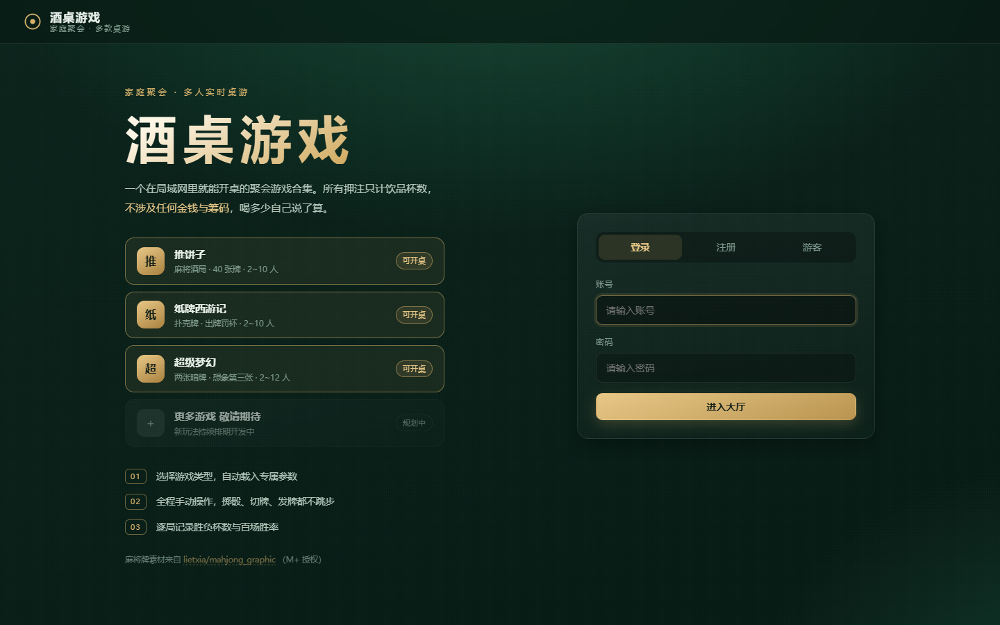 | 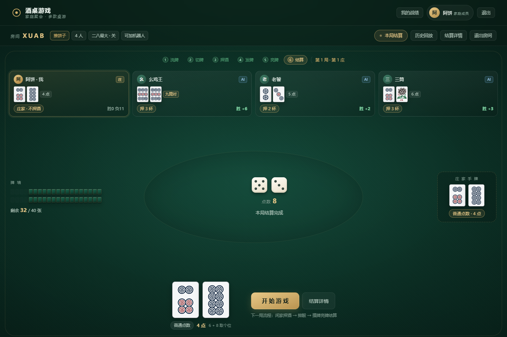 |

| 推饼子 · 本局结算 | 推饼子 · 历史回放 |
| --- | --- |
| 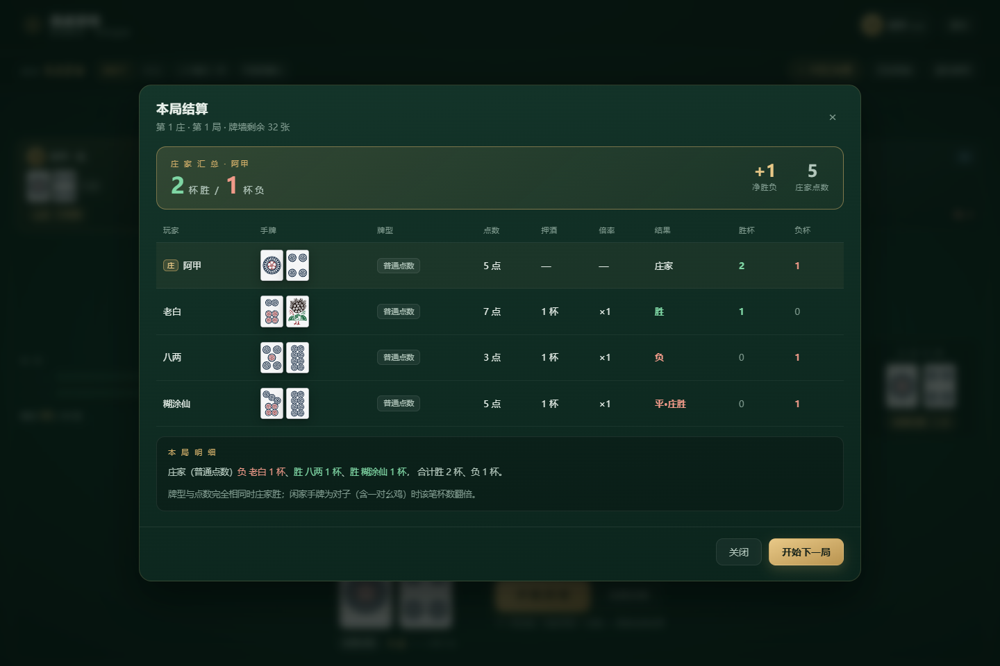 | 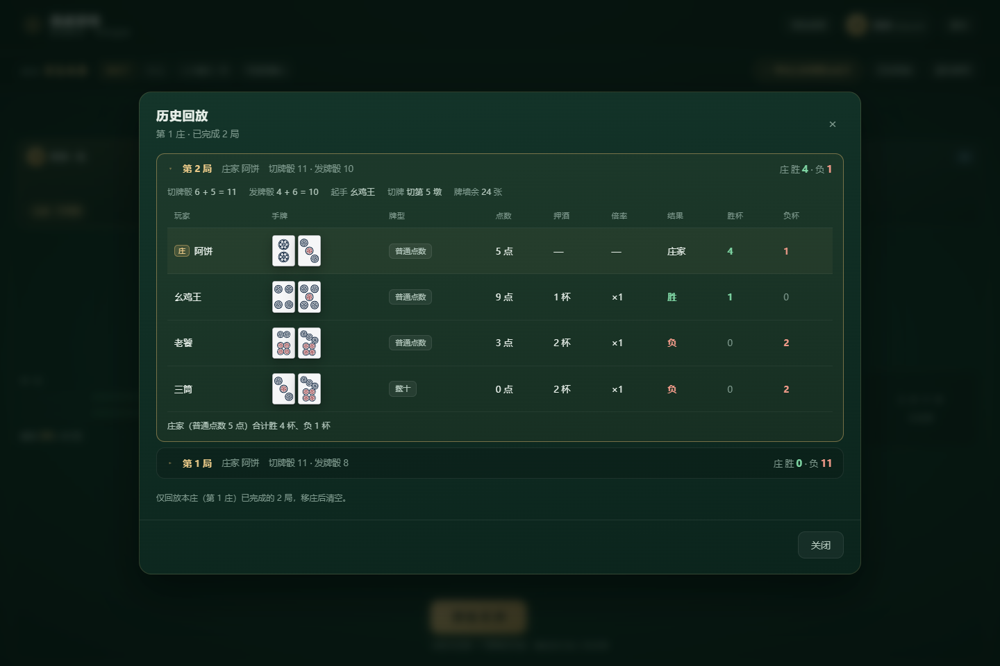 |

| 西游记 54 张 · 选牌出牌 | 玩法说明（内置规则图） |
| --- | --- |
| 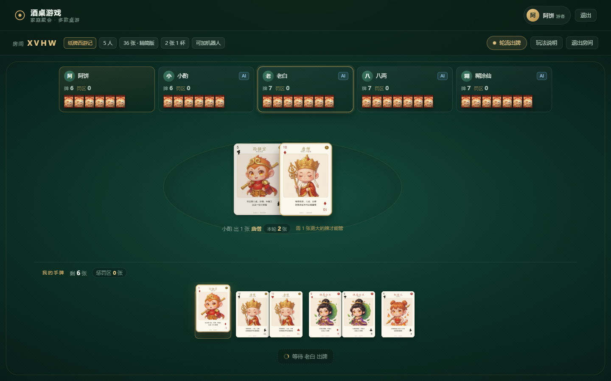 | 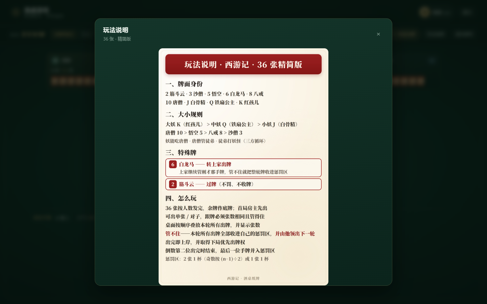 |

| 西游记 · 罚酒页面 | 西游记 36 张 · 精简版 |
| --- | --- |
| 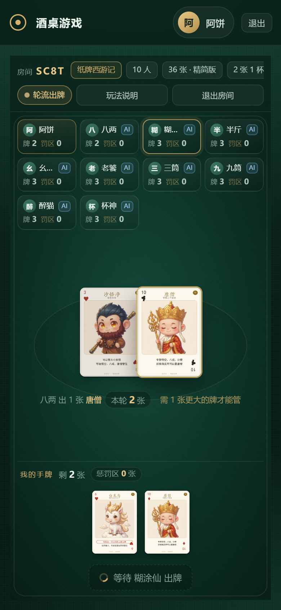 | 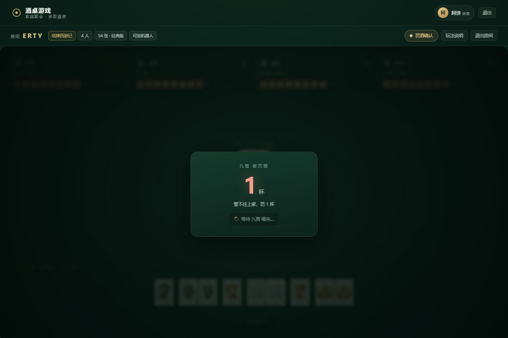 |
| 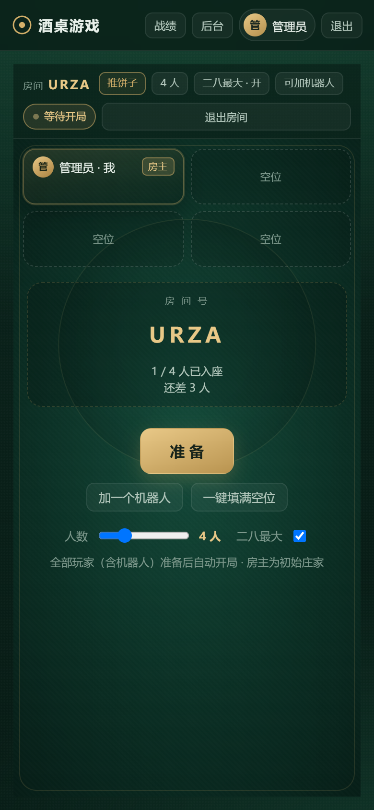 | 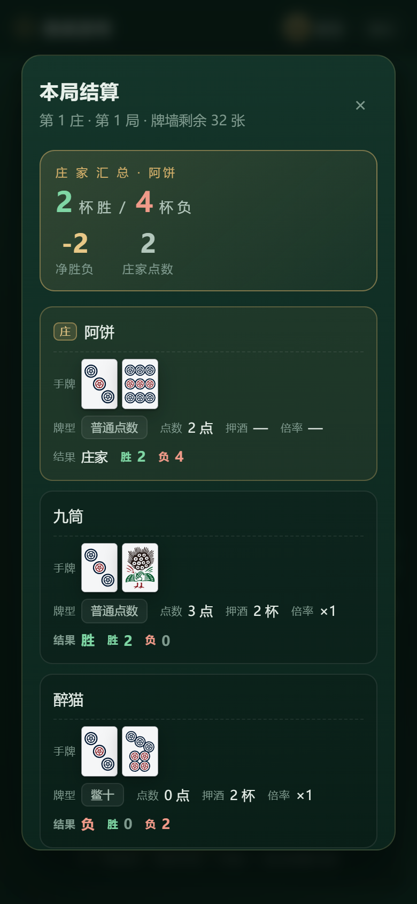 |
| 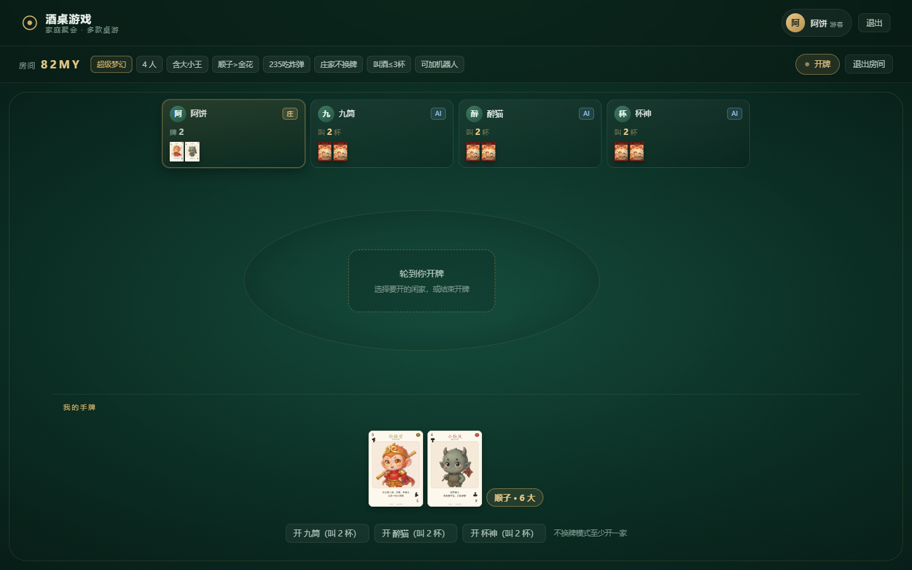 | 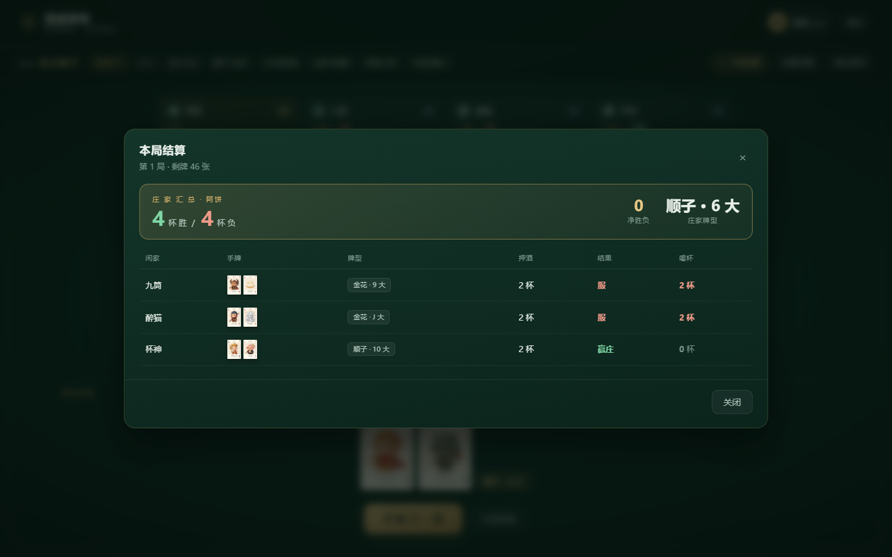 |

---

## 快速开始

### Docker Compose（推荐）

```bash
docker compose up -d --build
```

打开 `http://<宿主机IP>:9876`。

### 本地开发

```bash
npm install
npm start          # http://127.0.0.1:9876
npm test           # 两个游戏的规则单测 + 百场窗口测试
npm run test:e2e   # Socket 端到端联调
```

> 需要 Node.js **22.5+**（使用内置 `node:sqlite`，无任何原生编译依赖）。

### NAS 部署（群晖 / 威联通 / 极空间）

1. 把整个项目目录上传到 NAS，例如 `/volume1/docker/jiuzhuo-game`
2. SSH 进入该目录执行 `docker compose up -d --build`，
   或用图形化「Container Manager / 容器管理」导入 `docker-compose.yml`
3. 镜像基于 `node:24-alpine`，同时支持 **x86_64 与 ARM64**（无需本地编译）
4. 防火墙放行 9876 端口，家人用手机浏览器打开 `http://<NAS_IP>:9876`
5. `./data` 保存 SQLite 数据库，请纳入 NAS 备份计划

---

## 更新到新版本

三种方式，按方便程度排：

### 方式一 · 管理后台一键更新（推荐，需先挂 docker.sock）

进入 **管理后台 → 系统更新**，会显示当前版本 / 最新版本 / 本地镜像时间：

- 点【检查更新】→ 对比 GitHub 最新 Release
- 点【立即更新】→ 自动拉新镜像 + 重建容器，页面自动重连刷新

**前提**：`docker-compose.yml` 里挂了 docker.sock（本项目默认已加）

```yaml
    volumes:
      - ./data:/app/data
      - /var/run/docker.sock:/var/run/docker.sock   # ← 这一行
```

> ⚠️ **安全提示**：挂载 docker.sock 等于把「控制宿主机所有容器」的能力交给了这个容器。
> 家庭内网可接受；如果这台 NAS 还跑着重要服务、或对公网开放，建议删掉这一行，改用方式二。

**更新原理**：拉镜像后起一个临时 `docker:cli` 容器执行 `docker compose up -d`。
不能只 `docker restart` —— 重启不会重新解析 `:latest` 标签。

### 方式二 · SSH 手动更新

```bash
cd /volume1/docker/jiuzhuo-game
sudo docker compose pull
sudo docker compose up -d
```

不需要 root 登录，管理员账号加 `sudo` 即可（输自己的密码）。
只影响当前 compose 项目，**不会动其他容器**，`./data` 数据也不受影响。

### 方式三 · 群晖 Container Manager 面板

「项目」里停止 → 「映像」里删掉旧镜像 → 项目重新「启动」（会自动拉）。

> 面板对 `latest` 标签的更新检测有时会偷懒，拉完记得**删旧镜像再启动**。

### 更新后确认版本

一条命令看容器启动时间和镜像：

```bash
sudo docker ps --filter name=jiuzhuo-game
```

或直接看浏览器标签页标题 / 管理后台「当前版本」。

**浏览器记得强刷**（Ctrl+Shift+R / Cmd+Shift+R），否则可能加载到缓存的旧前端。

> ⚠️ 从 v1.1.0 及更早版本升级到 **v1.2.0** 时，`docker-compose.yml` 多了 docker.sock 挂载，
> 必须先更新这个文件再 `docker compose up -d`（只 `pull` 镜像不会重建容器，新挂载不生效）。

---

## 账号

| 类型 | 说明 |
| --- | --- |
| 内置管理员 | 首次启动自动创建，账号密码由 `ADMIN_USERNAME` / `ADMIN_PASSWORD` 决定。首页不展示任何账号密码，请部署后立即登录修改 |
| 注册账号 | 自建账号密码，保存游戏偏好，并记录**分游戏的百场胜率** |
| 游客 | 一键进入，使用默认参数；关闭标签页即清空（同一标签页刷新可恢复座位） |

---

## 大厅与房间

- 大厅展示全部在线房间：房间号、房主、人数 / 上限、游戏类型、玩法配置、状态
- 创建房间**先选游戏类型**，选中后自动载入该游戏的专属参数与规则说明
- 人数统一 2~10 人，可一键用 AI 机器人填满空位
- **所有座位（含机器人）全部准备后**才开局；房主是推饼子的初始庄家
- 首页游戏条展示**全部玩法**（含排期中的「骰子吹牛」，标灰显示「敬请期待」，不可开桌）；
  登录页游戏库随机挑 **3 款**，末尾固定一张「更多游戏 敬请期待」
- **观战**：牌局进行中的房间可直接进入观战，不占座位、不参与出牌；观战者只看公共信息（桌面牌、牌堆、骰子、押酒），**任何玩家手牌都不可见**；管理员观战为上帝视角

---

## 商城 · 背包 · 设置

### 积分商城

- 注册玩家初始 **1000 积分**；顶栏【积分商城】浏览与兑换
- **兑换后先进入背包**，不会立即生效，需要到设置页主动「使用 / 装备」
- 商品分三类：**一次性**（用完消失）、**永久**（长期可切换）、**限时**（到期自动失效）
- 管理后台可改商品定价、上下架，并给玩家加减积分

| 商品 | 价格 | 类型 | 说明 |
| --- | --- | --- | --- |
| 胜率清零卡 | 50 | 一次性 | 清空自己全部游戏的百场胜率记录 |
| 西游记牌面 | 100 | 永久 | 角色插画 + 大号数字角标的牌面皮肤 |
| 暖阳主题 | 120 | 永久 | 橙棕木质色调主题 |

### 用户设置（顶栏 ⚙️）

| 分组 | 内容 |
| --- | --- |
| 音频 | **背景音乐 / 音效 两个独立开关**（可只开音效不要 BGM） |
| 牌面 | 经典牌面（默认，CC0 标准扑克）/ 西游记牌面（需购买） |
| 主题 | 墨绿（默认）/ 暖阳（需购买） |
| 我的背包 | 列出已拥有道具，一次性道具显示「使用」，永久道具显示「装备 / 卸下」 |

- 牌面与主题**按玩家各自生效**：你买并装备后只影响你自己的视角，别人看到的仍是经典牌面
- 主题通过 `body.theme-warm` 覆盖 CSS 变量实现，不改变任何布局
- 牌面渲染智能适配：**经典牌面自带数字 → 不再叠角标**；**西游记插画无数字 → 叠加大号数字 + 花色角标**

---

# 一、推饼子

牌组：**1~9 筒各 4 张 + 幺鸡 4 张 = 40 张**。每人 2 张。

- **幺鸡算 0 点，一筒算 1 点**，其余按牌面 1~9 点
- 两张点数相加取个位定大小，**0 点（鳖十）最小**
- **对子不计点数**，直接显示为「九筒对 / 三筒对」，牌型大于任何普通点数

### 牌型大小（双模式）

**关闭二八最大（默认）**：`幺鸡对 > 对子 > 点数（0 点最小）`

**开启二八最大**：`二八杠（二筒+八筒） > 幺鸡对 > 对子 > 点数`

- 牌型与点数完全相同 → **庄家胜**
- 闲家手牌为对子（含幺鸡对）时，该笔胜负杯数 **×2**

### 一局流程（全部手动，不会自动跳过）

| 步骤 | 操作者 | 动作 |
| --- | --- | --- |
| 1 | 庄家 | 【洗牌】→ 40 张打乱，奇偶交替分成上下两叠牌墙 |
| 2 | 庄家 | 【掷骰定切牌人】→ 点数之和决定由谁切牌 |
| 3 | 被点中的闲家 | 选择【切牌】或【不切牌】 |
| 4 | 全部闲家 | 各自押 1 / 2 / 3 杯（庄家不押） |
| 5 | 庄家 | 【掷骰发牌】→ 点数定起手位，依次发 2 张 |
| 6 | 庄家 | 【亮牌】→ 手牌置于牌桌中心 |
| 7 | 全部闲家 | 各自【亮牌】→ 全部亮完后自动结算 |
| 8 | 庄家 | 查看结算面板，【开始游戏】进入下一局 |

### 牌墙与切牌

牌墙是**上下两叠**（对应真实牌桌上码好的两排牌），桌面按 3D 透视渲染并显示各层剩余张数。

- **分叠**：洗好的 40 张**奇偶交替**拆分 —— 第 1、3、5… 张为**上层**，第 2、4、6… 张为**下层**，各 20 张
- **抓牌**：每家**先抓上层一张、再抓下层一张**（所以不切牌时，每家拿到的是原牌序里相邻的两张）
- **切牌**：**只切上层**，下叠一张不动 —— 上层从骰子算出的切点分成两段、前后互换

这样切牌才真正有意义：上层牌序被重排后，各家「上层那张」全变，抓出来的组合随之改变。
若像单叠牌墙那样只做循环移位，切牌就只是换个起点、等于没切。

命中庄家的点数和：4 人局 1/5/9、5 人局 1/6/10、6 人局 1/7/11，其余点数按座位轮流分给闲家。

牌墙摸完 → 本庄统计 → 全员关闭面板自动准备 → 庄家【连庄】或指定新庄家 → 重新洗牌。

### 历史回放

牌桌顶栏【历史回放】可回看本庄内所有已完成的局：每局的切牌骰、发牌骰、起手位、切牌墩数，
以及全部玩家的手牌、牌型、点数、押酒杯数、倍率与胜/负杯。移庄后清空。

---

# 二、纸牌西游记

创建房间时选 **54 张经典版** 或 **36 张精简版**，选 36 张时还会出现
**2 张 1 杯 / 1 张 1 杯** 的罚杯换算选项。牌桌右上角【玩法说明】随时可看内置规则图。

## 牌面身份（54 张全套）

| 牌 | 角色 | 阵营 | 牌 | 角色 | 阵营 |
| --- | --- | --- | --- | --- | --- |
| 大王 | 如来 | 仙界 | 9 | 牛魔王 | 妖界 |
| 小王 | 观音 | 仙界 | A | 金翅大鹏 | 妖界 |
| 10 | 唐僧 | 仙界 | K | 红孩儿 | 妖界 |
| 5 | 悟空 | 仙界 | Q | 铁扇公主 | 妖界 |
| 8 | 八戒 | 仙界 | J | 白骨精 | 妖界 |
| 3 | 沙僧 | 仙界 | 7 | 蜘蛛精 | 妖界 |
| 6 | 白龙马 | 仙界（最小） | 4 | 小钻风 | 妖界 |
| 2 | 筋斗云 | 特殊 | | | |

## A 方案 · 54 张经典版

- **仙界**：大王 > 小王 > 唐僧 10 > 悟空 5 > 八戒 8 > 沙僧 3 > **白龙马 6**（仙界最小）
- **妖界**：A > K > Q > J > 9 > 7 > 4
- **克制**：妖精能管唐僧；除唐僧外的仙界牌能管妖精
- **6 白龙马**：这里就是**一张普通的仙界最小牌**，能管妖精、也能被其它仙界牌管，**没有转上家**
- **2 筋斗云**：过牌，不罚也不收牌

### 流程

1. 54 张按人数全发，余数作底牌；首局**持红桃 4 者先出**
2. 每次出 **1~4 张同点牌**，**领出时可以自己选张数**（点第 N 张就是出 N 张，或用张数按钮）
3. 跟牌必须**张数相同且管得住**
4. 管不住 → **罚 1 杯**，进入罚酒页面，点【喝完了】才继续
5. 一圈都管不住 → 出牌人重新领出
6. 桌面上按出牌顺序**叠放本轮所有已出的牌**，并标出「本轮 N 张」
7. 出完牌的玩家上岸；**只剩最后一人时结束**，其剩余手牌每张罚 1 杯

## B 方案 · 36 张精简版

牌组：2 / 3 / 5 / 6 / 8 / 10 / J / Q / K 各 4 张，共 36 张。

- **牌力**：大妖 K（红孩儿） > 中妖 Q（铁扇公主） > 小妖 J（白骨精） > 唐僧 10 > 悟空 5 > 八戒 8 > 沙僧 3
- **循环克制**：妖吃唐僧 → 唐僧管徒弟 → 徒弟打妖怪
- **2 筋斗云**：过牌（不罚、不收牌）
- **6 白龙马**：**转上家出牌**——牌留在桌面，由上家继续管刚才那手牌；
  上家管得住就换他压，管不住就把整轮牌收进惩罚区

### 流程

1. 36 张按人数发，余数作底牌；首局由**房主先出**
2. 每次出 **1~4 张同点牌**，领出时可自己选张数（点第 N 张就是出 N 张，或用张数按钮）
3. **跟牌必须张数相同且管得住** —— 这条对 **2（筋斗云）/ 6（白龙马）同样生效**：
   桌面 3 张，跟牌也必须出 3 张 2 或 3 张 6，手上不够就不能出
4. 桌面按出牌顺序**叠放本轮所有已出的牌**并显示张数，直到有人收牌
5. 管不住 → **本轮所有人打出的牌全部收进自己的惩罚区**（**含打出的 2/6，全部计入罚杯张数**），
   并**由他领出下一轮**
   （例：5 人依次各出一张，轮到第一个人管不住，这 5 张全进他的惩罚区，下一轮由他先出）
6. 出完牌的玩家上岸，并获得**下局优先出牌权**；其余玩家继续
7. **倒数第二位出完时结束**：最后一位的手牌 + **桌面上剩余的牌**，全部并入他的惩罚区一起折算罚杯

> 牌数守恒：36 张最终只会落在「各人惩罚区」里，弃牌堆只由发牌余数产生（36/2、36/3、36/4、36/6 都整除，
> 弃牌堆为 0；36/5、36/8、36/10 之类的余数才进弃牌堆）。

### 罚杯换算

| 选项 | 算法 |
| --- | --- |
| 2 张牌 1 杯（默认） | 惩罚区偶数张 ÷2；奇数张 (n−1)÷2 |
| 1 张牌 1 杯 | 惩罚区每张 1 杯 |

结束后展示每位玩家惩罚区张数与折算杯数，被罚的玩家依次在罚酒页面点【喝完了】。

---

## 百场胜率

- 每局结束为每位注册玩家记一条战绩；西游记按**名次**判定胜负（第一名记胜，其余记负）
- 每位玩家**每款游戏只保留最近 100 场**，超出自动删除
- 顶栏【我的战绩】查看胜率、胜/负/平、净杯数、最近 20 场走势；管理后台也可查看
- 游客不记录战绩

## 音效、语音播报与背景音乐

- **音效**：洗牌 / 掷骰 / 发牌 / 切牌 / 出牌 / 亮牌 / 押酒 / 罚酒 / 胜负 / 轮到你 / 点击 / 移庄，全部由 Web Audio 实时合成，不依赖音频文件
- **语音播报**：推饼子庄家亮牌点数、西游记「数量 + 量词 + 角色」整句播报、超级梦幻「押酒 / 锁全场 / 我服了 / 我不服 / 闷牌」等，
  用 edge-tts 预合成后预解码缓存、无缝串播
  - 西游记：13 个角色 × 1~4 张 = **52 条整句**（如「一只猪八戒」「两匹白龙马」「三个筋斗云」），避免「数词 + 角色」两条拼接的停顿
  - 白龙马改为形象化的 **「一杆回马枪 / 两杆回马枪…」**（效果是转上家出牌）
  - 推饼子庄家：`庄 X 点，X+1 点胜`；0 点播「庄憋十，有点胜」；9 点播「庄九点，点子不报」
- **背景音乐**：实时合成中式五声音阶——大厅/登录页为平静散板，进入牌局自动切快节奏鼓点战斗版，切后台自动暂停
- **音频开关**：顶栏 🔊 一键全静音；**设置页里背景音乐与音效可分别独立开关**，状态本地持久化

---

## 隐私与安全

- 服务端按玩家视角脱敏：看不到其他玩家的具体手牌，只下发张数
- 所有动作在服务端二次校验阶段与操作者身份（含「只有被罚的人才能点喝完了」「只有第一名能开下一局」）
- 机器人决策与前端高亮共用同一份「合法着法」计算结果，保证界面能点的和引擎认的一致
- 密码 bcrypt 加盐哈希；会话 token 存库可吊销；停用账号后会话立即失效

---

## 素材来源

| 素材 | 来源 | 授权 |
| --- | --- | --- |
| 麻将牌面（一筒~九筒、幺鸡） | [lietxia/mahjong_graphic](https://github.com/lietxia/mahjong_graphic) | M+ 授权，可商用 |
| 西游记卡牌 54 张 + 牌背 | 本项目美术出图 | 随项目使用 |
| 经典牌面 54 张 SVG | Public-Domain-and-CC0-Playing-Cards | CC0 / 公有领域 |
| 音效 / 背景音乐 | Web Audio 实时合成，无外部素材 | 无需授权 |
| 语音播报 mp3 | edge-tts 预合成（西游记整句 / 白龙马回马枪 / 推饼子庄家 / 超梦动作） | 无需授权 |
| 玩法说明图（54 / 36 张） | 同上，36 张版按同一版式制作 | 随项目使用 |

全部素材已**本地化保存**在 `public/assets/` 下，运行时不访问任何外部地址。
麻将授权全文见 `public/assets/mahjong/LICENSE-mahjong_graphic.txt`。

---

## 项目结构

```
server/
  index.js              # Express + Socket.IO 入口、事件路由、认证、商城/背包/皮肤、管理后台
  db.js                 # node:sqlite（用户 / 会话 / 偏好 / 百场战绩 / 商城商品 / 背包 / 皮肤）
  rooms.js              # 房间与座位、准备/开局、机器人调度、按视角脱敏（手牌可见性）
  games/
    registry.js         # 游戏注册表 + 排期玩法占位
    tuibingzi/          # 推饼子：cards / rules / engine / index（上下两叠牌墙）
    xihua/              # 纸牌西游记：cards / rules / engine / index
    supermeng/          # 超级梦幻：cards / rules / engine / index
public/
  assets/mahjong/       # 麻将牌矢量素材
  assets/xihua/         # 西游卡牌、牌背、54/36 张规则图
  assets/supermeng/cards/ # CC0 标准扑克 54 张 SVG（经典牌面）
  assets/audio/voice/   # edge-tts 预合成语音 mp3
  index.html
  css/base.css          # 设计系统、首页、大厅、战绩、后台、主题变量
  css/table.css         # 推饼子牌桌、麻将牌、3D 牌墙、动画、结算、历史回放
  css/xihua.css         # 扑克牌、西游记牌桌、罚酒页面、数字角标
  css/supermeng.css     # 超级梦幻牌桌、比牌区、牌堆与发牌动画
  css/settings.css      # 设置页、背包、皮肤选项
  js/app.js             # 应用外壳、Socket、路由、顶栏、首页游戏库、皮肤应用
  js/room.js            # 房间页：按 gameId 分流到各游戏视图
  js/tiles.js           # 麻将牌渲染
  js/playcards.js       # 扑克牌渲染（经典 / 西游记两套牌面 + 智能角标）
  js/xihua.js           # 西游记牌桌 / 罚酒 / 结算 / 规则图
  js/supermeng.js       # 超级梦幻牌桌 / 比牌 / 结算 / 历史
  js/settings.js        # 设置页：音频开关 / 牌面 / 主题 / 背包
  js/shop.js            # 积分商城
  js/audio.js           # 音效合成、语音播报、BGM、独立开关
  js/stats.js           # 我的战绩
  js/fx.js              # 洗牌 / 掷骰 / 切牌（只切上层）/ 发牌动画
  js/lobby.js js/auth.js js/admin.js js/ui.js
test/
  run.js                # 推饼子引擎单测
  xihua.js              # 西游记引擎单测 + 自动对局模拟
  supermeng.js          # 超级梦幻引擎单测
  stats.js              # 百场窗口裁剪测试
  e2e.js / e2e-xihua.js / e2e-supermeng.js / e2e-extra.js  # Socket 端到端
  shots*.js             # 无头浏览器截图巡检
```

### 新增一款游戏

1. 在 `server/games/` 下新建目录并导出统一接口：
   `id / name / minPlayers / maxPlayers / configSchema / defaultConfig / normalizeConfig /
   describeConfig / rulesSummary / createState / applyAction / waitingSeats /
   pendingBotActions / serialize`，可选 `evalHand`（手牌摘要）、`hintsFor`（可出牌提示）、
   `rulesVariants`（按配置切换规则说明）、`revealHandsAtEnd`。
2. 在 `registry.js` 里 `registerGame(...)`。
3. 前端在 `js/room.js` 里按 `gameId` 增加对应视图。

创建房间弹窗的配置项会根据 `configSchema` **自动生成**（支持 number / boolean / enum 与条件显示），
大厅、房间码、准备机制、逐局战绩与百场胜率**全部自动复用**。

---

## 常见问题

**Q：局域网找不到服务？** 确认端口映射为 `9876:9876`，放行防火墙，手机与 NAS 同网段。

**Q：想改对外端口？** 容器内固定 9876，只改 compose 左边，例如 `"8080:9876"`。

**Q：数据在哪？** `./data/jiuzhuo.db`（含 `-wal`、`-shm`），停止容器后复制整个 `data` 目录。

**Q：有人中途掉线？** 座位保留 45 秒；期间轮到他操作时由自动托管代打，避免卡死。

**Q：发牌除不尽怎么办？** 多出来的牌作为底牌不发，牌桌上会显示底牌张数。

---

## 技术栈

Node.js 22+/24 · Express 4 · Socket.IO 4 · node:sqlite · bcryptjs ·
原生 ES Modules + CSS3


---

## 超级梦幻（梦幻扎金花 · 两张暗牌版）

每人 2 张暗牌、无公牌，**想象第 3 张**组成最大牌型；闲家依次押酒、庄家开牌逐家结算。心理战拉满。

### 牌型（从大到小，创建房间可选顺子/金花先后）

| 牌型 | 判定 |
| --- | --- |
| 天炸 | 大王 + 小王（最高，235 也不吃） |
| 炸弹 | 两张同点 = 真炸；王 + 牌 = 假炸（点数按那张牌） |
| 同花顺 | 同色且相邻 / 隔一张 |
| 顺子 / 金花 | 相邻或隔一张 = 顺子；同色 = 金花（顺序可配） |
| 单牌 | 取两张里最大那张（A 最大、2 最小） |

- **没有对子**：既不同色、也不相邻/隔一的，直接按最大那张算单牌。
- **235**：手牌 2、5 且不同色，可吃真炸与单癞假炸（不吃天炸）；遇非炸弹则按单牌（点数 5）。
- **A 可当 1**（可选）：开则 A、2 与 A、3 组成 A23 顺子，关则只能 QKA。
- **大小王当癞子**（可选）：王与另一张固定取最大牌型，不因对手变化。

### 流程

1. **发牌**（暗置 2 张）
2. （可选）**闷牌声明**：从庄家下家顺时针，每人选「闷牌」或「看牌」；庄家最后声明
3. **看牌反转牌面**：选择看牌的玩家翻明自己的两张牌
4. 从庄家下家顺时针**叫酒**（1 ~ 上限杯）；首家叫 2 或 3 杯时，尾家可**锁酒**（全场同杯）
5. （可选）**庄家换牌**：看牌后两张全换、喝 1 杯；换 1 手 / 换 2 手 = 整个任期换 1 / 2 次。
   **庄家闷牌时不能换牌**
6. **庄家开牌**：逐个指定要开的闲家，被开的闲家选「服」或「不服」
7. 庄家可继续开下一家，或结束开牌（**所有模式都至少开一家**）
8. 本局结算 → 下一局

### 顺子（想象第 3 张）

想象牌不是随便想的，由手牌唯一确定：

| 手牌关系 | 想象牌 | 例子 |
| --- | --- | --- |
| 相邻（差 1） | 往上补一张 | 6、7 → 补 8 → **678** |
| 隔一张（差 2） | 补中间那张 | 5、7 → 补 6 → **567** |
| 相邻但顶到 A | 只能往下补 | K、A → 补 Q → **QKA** |
| 隔一张且含 A | 补中间 | Q、A → 补 K → **QKA** |

比较规则两层：

1. **先比顶牌**（顺子最大那张）—— 567（顶 7）< 678（顶 8）
2. **顶牌相同，比想象牌，想象牌越小越强** —— 三手都是 QKA（顶 A），于是 **KA > QA > QK**
   （KA 想象 Q=12、QA 想象 K=13、QK 想象 A=14）

### 炸弹最少叫 2 杯（默认规则）

- 拿到**炸弹**（真炸 / 假炸 / 天炸）的玩家，**叫酒最少 2 杯**，不能叫 1 杯
- **只约束「看牌」玩家**：闷牌看不到自己的牌，叫 1 杯允许，开牌后发现是炸弹也**不追溯**
- **235 不算炸弹**，不受限制
- 干 2 模式全场固定 2 杯，天然满足
- 前端「1 杯」按钮自动置灰，机器人同样遵守

### 结算

- **服**：闲家认输，喝**所押酒**（不翻倍），**不与庄家比牌**
- **不服**：比牌，输者喝**双倍**
- **闷牌**：闲家闷 + 庄家也闷 → 输者双倍；闲家闷 + 庄家看牌 → 闲家输双倍、庄家输**四倍**
- 相同牌型相同点数时**庄家胜**（官大）

### 亮牌与手牌保密

- **闷牌**：比牌只出输赢结果，不亮牌；牌面留到本庄统计统一展示
- **双方都看牌**：比牌时亮牌并置于桌面——但**只对「被开的闲家 + 庄家」可见**，
  **其他闲家看到的是牌背**（否则后面被开的闲家能照着庄家的牌决定服不服，庄家完全被动）
- 过滤在**服务端**完成：非当事人收到的数据里牌面字段直接是 `null`，抓包也看不到
- **本局结算**：只公开「庄家 + 被开过牌的闲家」；未被开牌的闲家手牌保持隐藏
- **本庄统计（移庄前）**：全部牌面公开

### 手牌延续（下一局发牌）

- **没被庄家开过牌的闲家，保留手牌进入下一局**
- 只有**被开过牌的闲家**和**庄家**重新发牌
- 因此本局结算不会提前亮出未被开牌玩家的手牌，避免下一局变明牌

### 闷牌 / 锁酒次数（按整场计）

| 项目 | 限制 | 说明 |
| --- | --- | --- |
| 闷牌 | **每人每场 3 次** | 独立计数；用完后该玩家本场只能「看牌」 |
| 锁酒 | **整场 1 次** | 锁后全场按锁定杯数，直到某局庄家**同时赢首尾两家**解锁；**解锁后不能再锁** |

**移庄或连庄后都算新一场**，闷牌 / 锁酒次数全部重置。

### 大回合

剩牌不足以给「庄家 + 被开牌玩家」各发 2 张时强制进入**移庄**，选定新庄家后重新洗牌开新大回合；
新庄家可**重设房间规则**（沿用或改）。

创建房间配置项：人数 2~12、大小王、顺/金花顺序、真假炸比法、235、A 当 1、闷牌、换牌、叫酒上限、机器人补位。
